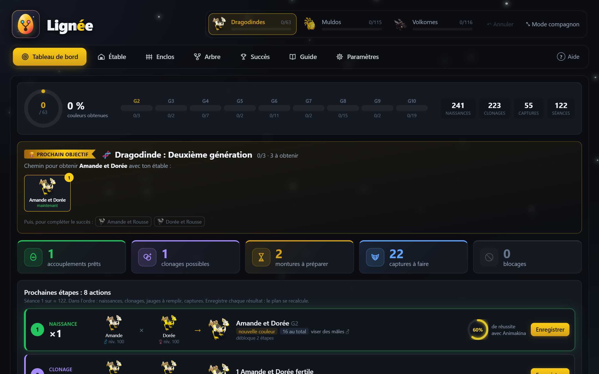
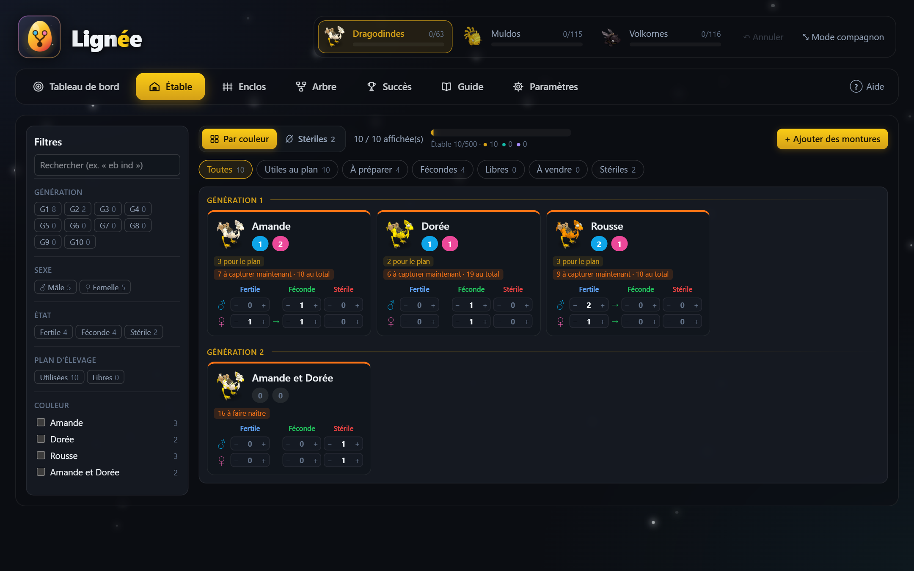
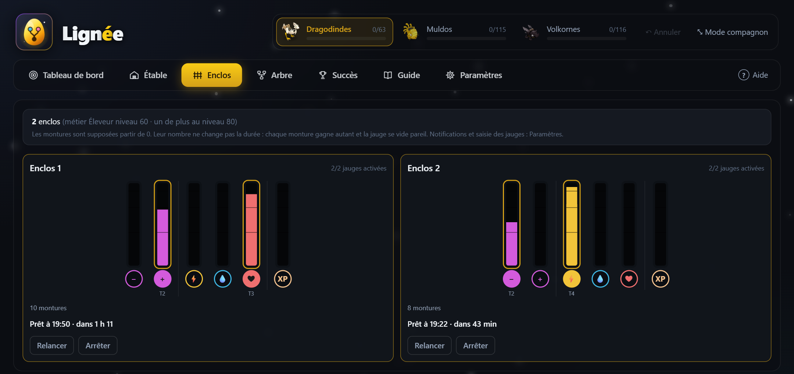
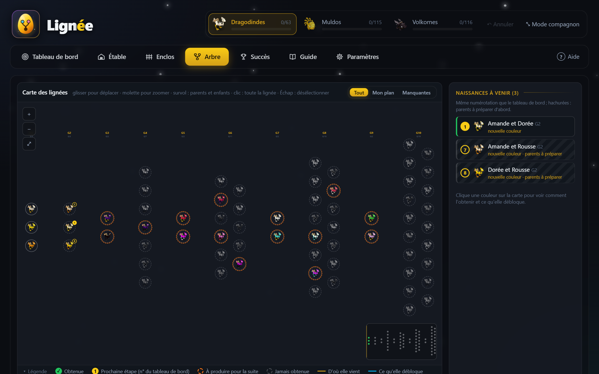
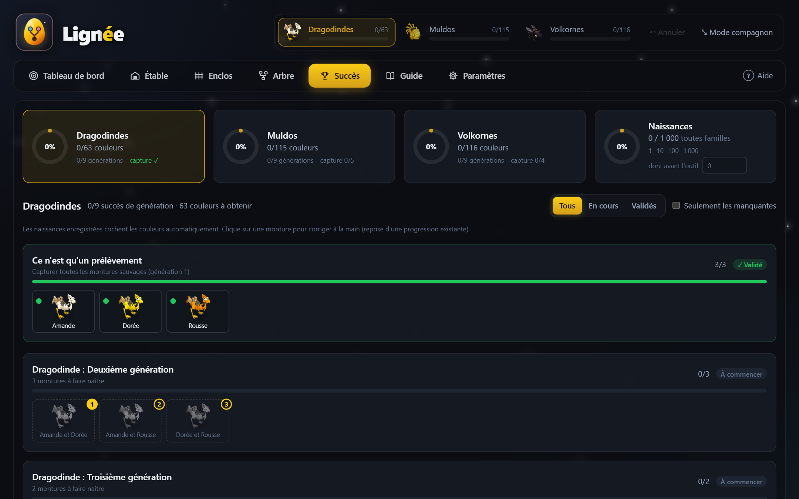

<div align="center">


# Lignée

**Le copilote de l'élevage pour Dofus 3.7**

Dragodindes, Muldos et Volkornes : Lignée te dit quoi accoupler, capturer et cloner, dans quel ordre, jusqu'à **tous les succès de génération**.

[](../../releases/latest)
[](../../releases)
[](../../releases/latest)
[](LICENSE)

### [⬇ Télécharger pour Windows](../../releases/latest)



</div>

---

## Pourquoi Lignée ?

Finir les succès de génération, c'est **294 couleurs** à faire naître sur trois familles. Le chemin est long, et on se perd vite entre les croisements, les makinas, les stériles et les jauges. Lignée part de **ton étable** et calcule le plan le plus court, séance par séance.

| | |
|---|---|
| 🧬 **Plan automatique** | Naissances, clonages, captures et préparations, numérotés dans l'ordre. Le plan se recalcule après chaque résultat. |
| ♻️ **Recyclage des stériles** | Deux stériles de même génération sont clonés en une monture fertile : plus de dix fois moins de naissances. |
| ⏱️ **Minuteurs d'enclos** | Jauges comme en jeu, heure de fin calculée, alertes de sérénité. Notification Windows et, en option, Discord. |
| 🌳 **Arbre des lignées** | Toutes les couleurs par génération, leurs parents et ce qu'elles débloquent. |
| 🏆 **Succès** | Cochés automatiquement à chaque naissance enregistrée. |
| 🪟 **Mode compagnon** | Une petite fenêtre toujours au premier plan, à garder à côté du jeu. |

## Aperçu

<table>
  <tr>
    <td width="50%"><br /><b>Étable</b> : tes montures par couleur, avec ce qu'il reste à capturer.</td>
    <td width="50%"><br /><b>Enclos</b> : jauges réglées comme en jeu, heure où tout est prêt.</td>
  </tr>
  <tr>
    <td width="50%"><br /><b>Arbre</b> : la carte de toutes les couleurs et le chemin pour les obtenir.</td>
    <td width="50%"><br /><b>Succès</b> : progression par famille et par génération.</td>
  </tr>
</table>

## Installation

1. Télécharge l'installateur Windows (`Lignee_x.y.z_x64-setup.exe`) dans la [dernière version](../../releases/latest).
2. Lance-le. L'application n'est pas signée par un éditeur reconnu, donc Windows SmartScreen peut afficher un avertissement : *Informations complémentaires → Exécuter quand même*.

**Mises à jour automatiques** : au démarrage, Lignée vérifie si une nouvelle version existe et propose *Installer et redémarrer*. Les nouveautés s'affichent ensuite dans l'application. Tes données sont conservées.

## Prise en main

À la première ouverture, une **visite guidée** en cinq chapitres te présente l'outil : Découverte, Gérer l'étable, Suivre le tableau de bord, Enclos et notifications, Au quotidien. Les chapitres pratiques se font sur une **étable d'exemple**, sans toucher à la tienne. On les relance avec le bouton **? Aide** ou depuis *Paramètres → Visite guidée*.

1. **Choisis la famille** (Dragodindes, Muldos, Volkornes) en haut de l'écran.
2. **Saisis ton étable** (onglet *Étable*) : pour chaque couleur, le nombre de mâles et de femelles, et leur état (fertile, féconde, stérile). Coche dans *Succès* les couleurs déjà obtenues.
3. **Suis le tableau de bord** : fais les actions en jeu dans l'ordre, puis enregistre chaque résultat. Le plan se recalcule.

## Les écrans

- **Tableau de bord** : la progression vers le prochain succès, puis les prochaines étapes regroupées par type.
  - **Naissances** : couples à accoupler, combien de fois, quelle makina utiliser et la chance d'obtenir la couleur visée. Les échecs et les jumeaux sont gérés.
  - **Clonages** : les paires de stériles à cloner.
  - **Préparer** : les jauges à remplir en enclos ; *✓ Toutes prêtes* passe tout en Féconde d'un coup.
  - **Captures** : combien de mâles et de femelles capturer, par couleur.
- **Étable** : tes montures par couleur, avec des filtres (à préparer, fécondes, stériles, utiles au plan, à vendre…).
- **Enclos** : les jauges de chaque enclos comme en jeu, en mode simple (paliers) ou avancé (valeur exacte). Lignée calcule l'heure où les montures sont prêtes, prévient quand la sérénité sort de sa zone ou qu'une jauge se vide, et envoie une notification Windows. Avec un relais gratuit partageable dans une guilde, la notification arrive aussi sur Discord, même Lignée fermée : voir [le guide du relais](docs/RELAIS_DISCORD.md) et [sa sécurité](docs/RELAIS_SECURITE.md).
- **Arbre** : toutes les couleurs par génération, avec les liens de parenté et le chemin pour obtenir une couleur.
- **Succès** : les couleurs par génération et les paliers de naissances.
- **Guide** : les règles d'élevage expliquées simplement.
- **Paramètres** : thèmes, fond d'écran, animations, minuteurs d'enclos, sauvegardes et mises à jour.

Chaque modification affiche une notification discrète avec **Annuler**.

## Comment le plan est calculé

- Il part des couleurs manquantes et remonte jusqu'à la génération 1, en réutilisant d'abord tes montures (les plus hauts niveaux pour les étapes les plus importantes).
- Chaque accouplement est **toujours un mâle et une femelle** : le plan choisit à l'avance le sexe des bébés (Animakina quand c'est utile) et de chaque capture.
- Les parents deviennent stériles ; deux stériles de même génération sont **clonés** en une monture fertile.
- Le plan suppose que chaque accouplement réussit. En cas d'échec, enregistre ce qui est né : le plan s'adapte.

Un test joue un élevage complet de zéro pour les trois familles et vérifie qu'il arrive à 100 % sans blocage.

## Données et règles

- Les arbres de croisement ([src/donnees](src/donnees/arbres_croisements_3.7.json)) sont vérifiés contre les objectifs officiels des succès du jeu.
- Les règles appliquées (chances, makinas, clonage, jauges…), leurs sources et leur niveau de confiance sont dans [docs/REFERENCE_ELEVAGE_3.7.md](docs/REFERENCE_ELEVAGE_3.7.md).
- En cas de doute, **l'interface de génétique du jeu fait foi** : signale l'écart dans une [issue](../../issues).

## Tes données

- Sauvegarde : `%APPDATA%\io.github.xenovyrion.lignee\lignee-sauvegarde.json`.
- Copies automatiques : une par jour dans le sous-dossier `sauvegardes` (les 15 dernières sont gardées).
- *Paramètres → Sauvegardes* : exporter, importer ou restaurer une copie.

<details>
<summary><b>Développement</b></summary>

Prérequis : Node.js 22+, Rust (stable) et les [prérequis Tauri pour Windows](https://tauri.app/start/prerequisites/).

```bash
npm install
npm test              # tests (moteur, simulation complète, sauvegardes)
npm run tauri dev     # application de bureau
npm run dev           # interface seule dans le navigateur (sauvegarde en localStorage)
```

| Dossier | Rôle |
|---|---|
| `src/moteur` | règles 3.7, planificateur, enclos, actions sur la sauvegarde (TypeScript pur, testé) |
| `src/ecrans` | interface React |
| `src/donnees` | arbres de croisement vérifiés, courbe d'XP, galerie de fonds d'écran |
| `src-tauri` | application Windows (sauvegarde dans AppData, mises à jour, notifications) |
| `relais` | relais Discord facultatif (Cloudflare Worker) |
| `docs` | référence des règles d'élevage, guides du relais, captures |

**Publier une version** : monter la version dans `package.json`, `src-tauri/tauri.conf.json` et `src-tauri/Cargo.toml`, commiter, attendre la CI, puis pousser une étiquette `vX.Y.Z`. Le workflow *Release* compile, signe et publie l'installateur et `latest.json`.

</details>

## Licence

© Xenovyrion. Lignée est **gratuit**. Son code est **visible mais pas libre** : il est publié sous la [PolyForm Strict License 1.0.0](LICENSE).

| ✅ Autorisé | ❌ Interdit |
|---|---|
| Utiliser l'application gratuitement, à titre personnel et non commercial | Copier le code dans un autre projet |
| Lire le code pour comprendre ou vérifier son fonctionnement | Le modifier, en dériver une autre application |
| Signaler un bug ou proposer une idée dans une [issue](../../issues) | Le redistribuer, le revendre ou en faire un usage commercial |

Pour toute autre utilisation, demande l'autorisation dans une [issue](../../issues).

---

<sub>Dofus est un MMORPG édité par [Ankama](https://www.ankama.com). Lignée est un outil de fan gratuit et non officiel, sans lien avec Ankama. Certaines illustrations sont la propriété d'Ankama Studio et de Dofus, tous droits réservés : les images des montures (via [DofusDB](https://dofusdb.fr)) et les fonds d'écran ([wallpapers officiels](https://www.dofus.com/fr/mmorpg/medias/wallpapers)) ne sont pas inclus dans le code, l'application les affiche depuis leur site d'origine, et les captures d'écran de cette page en montrent certaines. Caractéristiques des montures : merci à [Dofus pour les Noobs](https://www.dofuspourlesnoobs.com).<br>© 2026 Lignée · [Licence PolyForm Strict](LICENSE)</sub>
